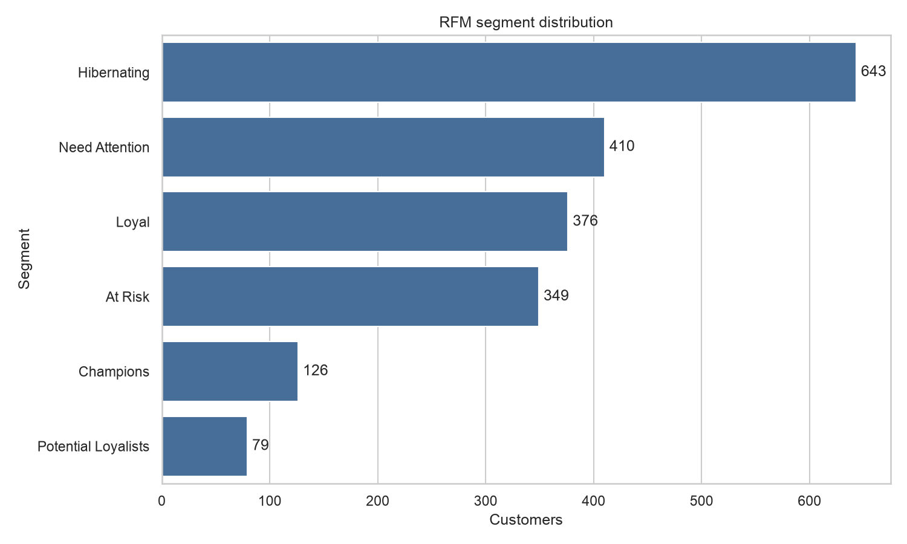
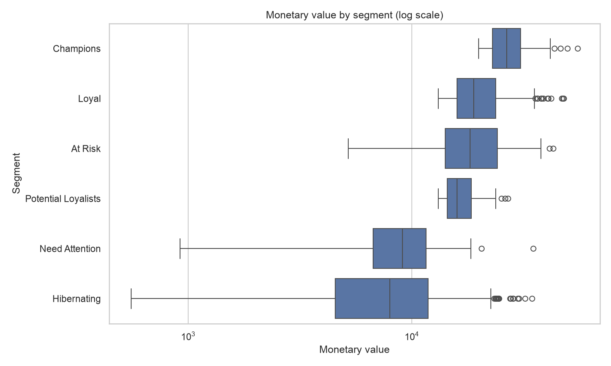
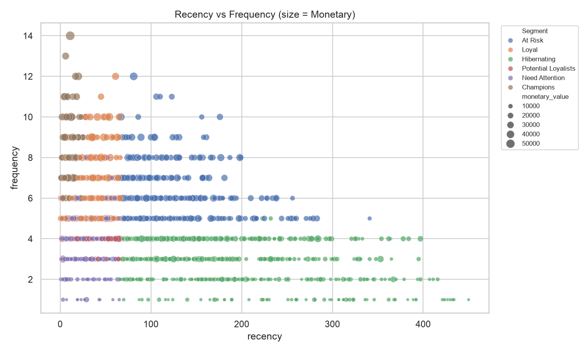
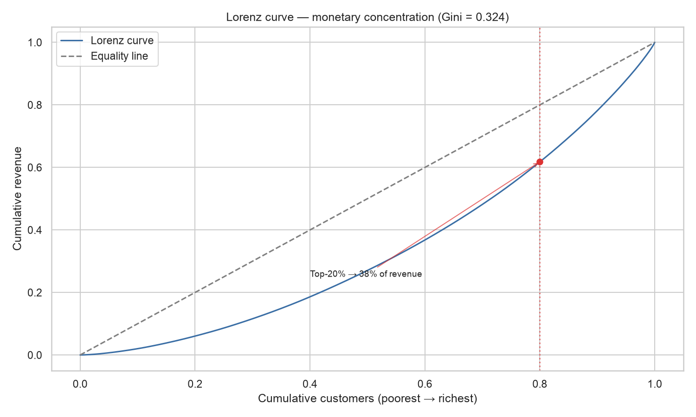
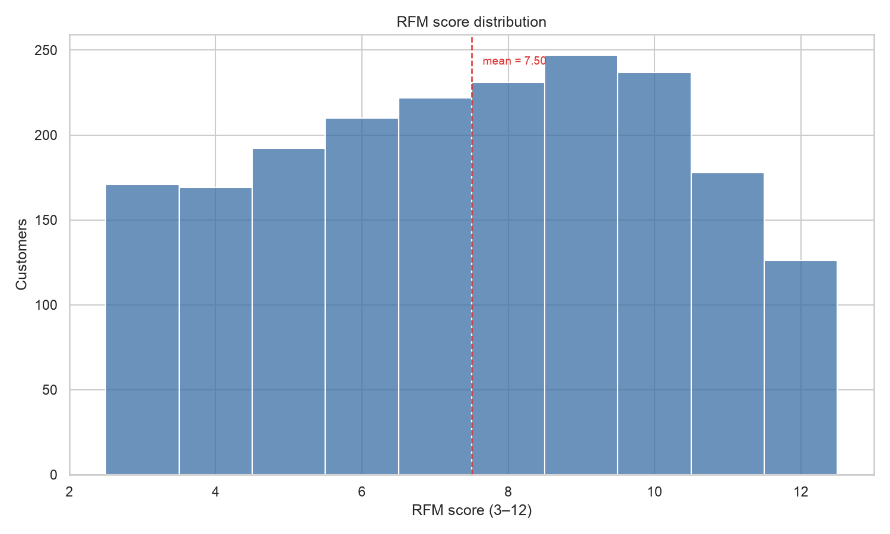
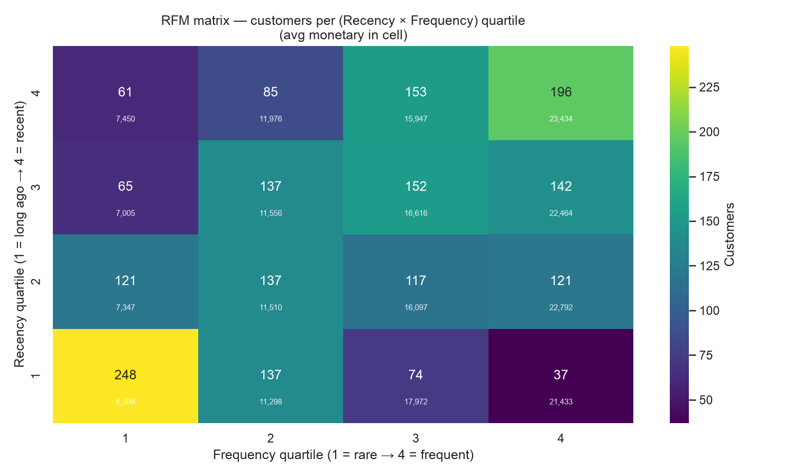
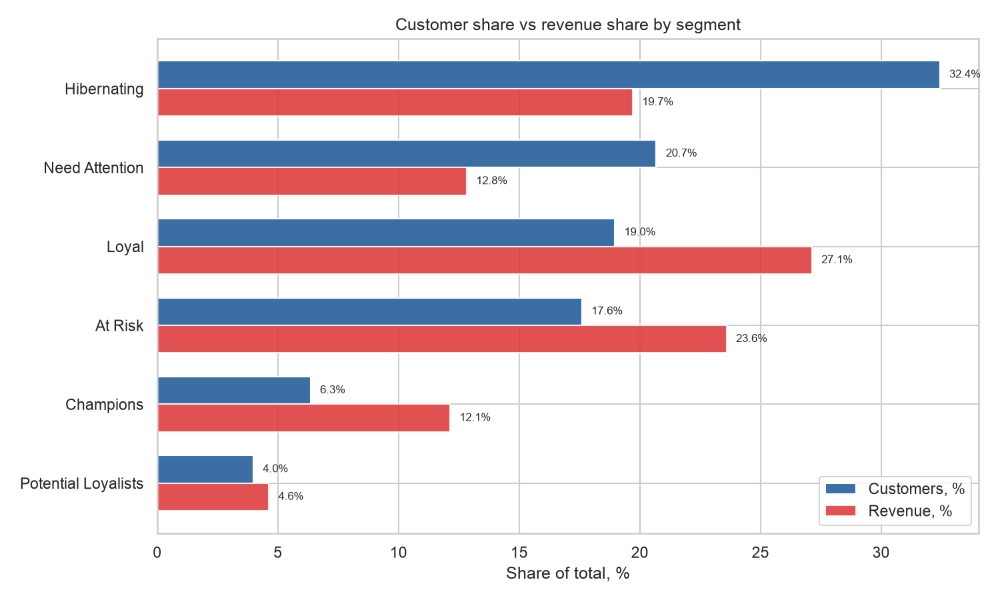
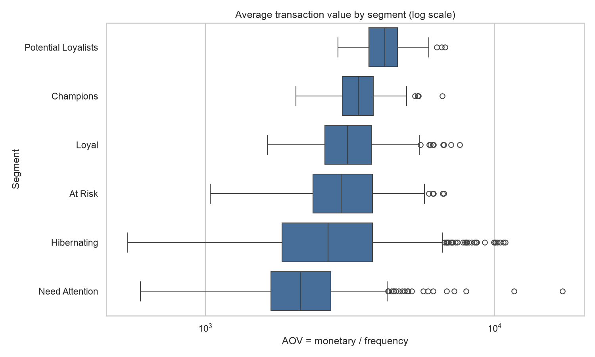
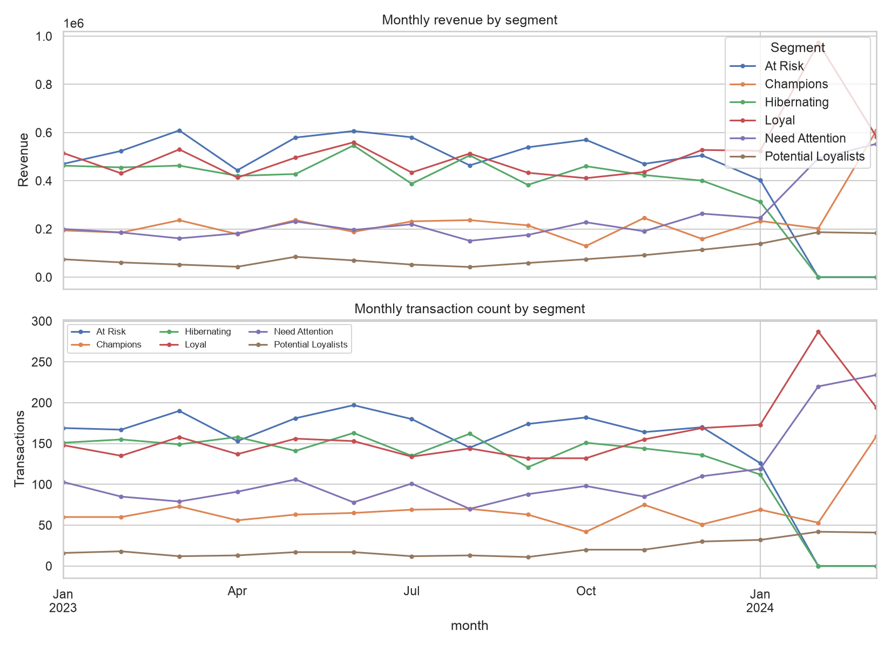

# RFM analysis of bank clients

> RFM segmentation of 1,983 bank clients on 9,492 transactions (after dropping flagged anomalies): Gini 0.324, top 20% hold 38.2% of revenue, mean RFM score 7.50.

## Navigation
- 🌐 [Portfolio site](https://nikitaboyarkin.github.io)
- 🏦 [Flagship case: Volta neobank](https://github.com/NikitaBoyarkin/volta-banking)
- 🧪 Related: [sql-analytics-case-study](https://github.com/NikitaBoyarkin/sql-analytics-case-study) · [churn-prediction](https://github.com/NikitaBoyarkin/churn-prediction) · [tableau_cohort_analysis](https://github.com/NikitaBoyarkin/tableau_cohort_analysis)

**▶ [Diagram: RFM segmentation of 1,983 bank clients](docs/diagrams/rfm-analysis.html)** — opens in a browser, no install, no build

**On this page:** [Situation](#situation) · [Task](#task) · [Actions](#actions) · [Result](#result) · [Background](#background) · [Method](#method) · [Results](#results) · [Chart gallery](#chart-gallery) · [Hypotheses](#hypotheses) · [Recommendations](#recommendations) · [Project layout](#project-layout)

## Situation

A retail bank's transaction log gives no unified view of client value: who is
worth protecting, who is about to churn, and which segment marketing should
target. Segment bank clients by transaction behavior using **Recency, Frequency,
Monetary** scoring, then map quartile combos to named segments and ship the
result as CSV + Excel + charts + an interactive dashboard.

## Task

Turn one synthetic transaction log into a targetable segment per customer, and
prove the segmentation has business sense rather than assuming it.

## Actions

- **Load & clean** — parse dates, drop rows flagged `is_anomaly == 1`.
- **RFM table** — per `customer_id`: `recency`, `frequency`, `monetary_value`.
- **Score quartiles 1..4** and derive a 3-digit `RFMClass` + `RFMScore` (3..12).
- **Segment** combo-based (not sum-based), so `444` and `233` no longer share a bucket.
- **Concentration** — Lorenz curve + Gini coefficient, plus per-segment `concentration_ratio`.
- **Hypotheses** — five testable + three untestable, each testable one reporting raw and Holm-adjusted p-values.
- **Export** — CSV, formatted Excel, charts (`images/`), and a Streamlit dashboard.

## Result

- **Gini = 0.324** — top 20% of customers hold 38.2% of revenue.
- **126 Champions** — 6.4% of clients → 12.1% of revenue (ratio 1.91).
- **643 Hibernating** — 32% of the base, under-indexing on revenue (ratio 0.61).
- **992 of 1,983 ≈ 50%** — At Risk + Hibernating is the main re-engagement pool.
- **47 tests** — pure pipeline functions + README/CSV binding.

Segment bank clients by transaction behavior using **Recency, Frequency, Monetary** scoring, then map quartile combos to named segments and export CSV + Excel + charts + an interactive dashboard.

## Background

Synthetic transaction log for 2,000 clients of a retail bank. The goal is to identify high-value clients, flag at-risk ones, and give marketing a targetable segment per customer.

- **Time period:** 2023-01-01 → 2024-03-30 (synthetic, reproducible via `generate_data.py`, seed 42)
- **Volume:** 10,000 transactions → 9,492 after the anomaly drop, **1,983 unique active clients**
- **Schema:** `customer_id, transaction_date, amount, product_category, payment_method, is_anomaly`

## Quick start

```bash
uv sync --all-extras          # or: pip install -e ".[dev,dashboard]"

python generate_data.py       # builds data/bank_rfm_dataset_10k_fixed.csv
python rfm_analysis.py        # writes data/rfm_output.csv, data/rfm_output_report.xlsx, images/*.png
python hypotheses.py          # runs the testable hypotheses over the RFM output
pytest                        # 47 tests — pure pipeline functions + README/CSV binding
streamlit run dashboard/app.py   # interactive dashboard (5 tabs)
```

## Method

1. **Load & clean** — parse dates, drop rows flagged `is_anomaly == 1`.
2. **RFM table** — per `customer_id`: `recency` (days since last txn vs snapshot +1d), `frequency` (txn count), `monetary_value` (sum).
3. **Score quartiles 1..4** (higher = better):
   - `R_Quartile`: 4 = most recent, 1 = longest ago
   - `F_Quartile`: 4 = most frequent, 1 = rarest
   - `M_Quartile`: 4 = highest spend, 1 = lowest
   - `RFMClass`: 3-digit string (`444` = best, `111` = worst); `RFMScore` = sum (3..12)
4. **Segment** — combo-based (not sum-based), so `444` and `233` no longer share a bucket:

| Condition | Segment |
|---|---|
| R≥4 & F≥4 & M≥4 | Champions |
| R≥3 & F≥3 & M≥3 | Loyal |
| R≥3 & F≥2 & M≥3 | Potential Loyalists |
| R≤2 & F≥3 | At Risk |
| R≤2 & F≤2 | Hibernating |
| else | Need Attention |

5. **Concentration** — Lorenz curve + Gini coefficient verify segmentation has business sense; per-segment `concentration_ratio = revenue_share / customer_share` flags over/under-indexing.
6. **Export** — CSV (`data/rfm_output.csv`), formatted Excel (`data/rfm_output_report.xlsx`), charts (`images/`), interactive dashboard (`dashboard/`).

## Results

| Segment | Customers | Avg recency | Avg frequency | Avg monetary | Avg RFM |
|---|---:|---:|---:|---:|---:|
| Champions | 126 | 11.35 | 8.16 | 27,608.83 | 12.00 |
| Loyal | 376 | 32.13 | 6.40 | 20,692.31 | 10.32 |
| Potential Loyalists | 79 | 32.62 | 3.97 | 16,777.17 | 8.57 |
| At Risk | 349 | 123.85 | 6.30 | 19,381.56 | 8.37 |
| Need Attention | 410 | 30.39 | 4.07 | 8,962.92 | 7.20 |
| Hibernating | 643 | 177.47 | 2.92 | 8,786.79 | 4.56 |

Mean RFM score across the base is **7.50** — exactly the midpoint of the 3–12 range. **Monetary concentration:** Gini = 0.324 — the top 20% of customers hold **38.2%** of revenue. Champions over-index on revenue (ratio 1.91), Hibernating under-indexes (ratio 0.61).

## Chart gallery

Every chart below follows the same reading order: **what it shows** (description) → the chart → **what it means** (insights).

### 1. Segment distribution

**Description.** Horizontal bar chart of customer counts per RFM segment, ordered from most to least populated. Answers the first portfolio question: how big is each cluster of the client base?



**Insights.**
- **Hibernating (643, 32%)** is the single largest pool — roughly 3 out of 10 clients sit in the low-engagement bucket.
- **Champions (126, 6%)** is small but strategically critical; **At Risk (349)** is the larger imminent-churn group.
- Combined, **At Risk + Hibernating = 992 of 1,983 ≈ 50% of the base** — the main re-engagement opportunity.

### 2. Monetary by segment

**Description.** Boxplot of lifetime monetary value per customer by segment (log scale), ordered by segment median. Shows where high spenders actually live.



**Insights.**
- **Champions carry the highest average monetary (≈ 27.6k)**, followed by Loyal (≈ 20.7k) and At Risk (≈ 19.4k) — value concentrates in the segments scoring highest on R/F.
- **Hibernating (≈ 8.8k) and Need Attention (≈ 9.0k)** sit at the bottom — recent-but-small accounts and dormant ones with limited upside.
- The log-scale spread confirms skew: within every segment a small minority dominates spend, which is what the Gini of 0.324 summarizes globally.

### 3. Recency vs Frequency (size = Monetary)

**Description.** Scatter of every customer by recency (days since last transaction) and frequency; point size encodes monetary value, color encodes segment. The canonical RFM map in one view.



**Insights.**
- **Champions** cluster in the low-recency / high-frequency corner (top-left): 11.4 days since last txn, 8.2 txns each; **Hibernating** fills the bottom-right (177.5 days, 2.9 txns).
- **At Risk** sits between the active and dormant clusters — 123.9 days of recency but still 6.3 txns, far more frequent than Hibernating's 2.9 — the clearest win-back target before they slide.
- Bubble size shows the long tail of high-monetary clients spread across several segments, not only Champions.

### 4. Lorenz curve — monetary concentration

**Description.** Cumulative share of revenue vs cumulative share of customers (poorest → richest). The distance from the equality diagonal is the inequality, summarized by the Gini coefficient.



**Insights.**
- **Gini = 0.324** — a meaningfully unequal distribution of monetary value, though far from extreme.
- **Top-20% of customers generate 38.2% of revenue** — about 1.9× their proportional share (38.2 / 20), so the curve bends, but this book does not follow an 80/20 Pareto shape.
- Segmentation still has business sense: the top quintile carries nearly twice its weight in value, so targeting the right segment pays off above its customer count.

### 5. RFM score distribution

**Description.** Histogram of the composite RFM score (3–12) across all customers; dashed line marks the mean (7.50). A quick shape check of overall engagement health.



**Insights.**
- The distribution is roughly bell-shaped around a mean of **7.50** — exactly the midpoint of the 3–12 range, so overall engagement is balanced rather than skewed low.
- Left tail (scores ≤ 4, **340 clients**) is the dormant mass; right tail (score 12, **126 clients**) is exactly the Champions count.
- Fewer clients at the extremes than in the middle — most of the book is "average," which is where segmentation adds the most leverage.

### 6. RFM matrix heatmap

**Description.** 4×4 grid of customer counts per (Recency × Frequency) quartile combo — the classic RFM matrix. Cell shade = count; number inside each cell = average monetary value of that cell.



**Insights.**
- The **(R=4, F=4)** cell (recent + frequent, **196 clients**) is the Champions core with avg monetary ≈ 23,434 — nearly 1.6× the whole-book average of ≈ 14.5k (total monetary 28.67M ÷ 1,983 customers).
- The **(R=1, F=1)** corner (**248 clients**) is the deep-sleep mass — the single largest cell.
- **Avg monetary rises more with frequency than with recency** (reading down columns vs across rows) — frequency is the stronger value signal, so retention campaigns should target frequency, not just freshness.

### 7. Customer share vs revenue share by segment

**Description.** Grouped horizontal bars: each segment's share of customers (%) against its share of revenue (%). A revenue bar visibly longer than the customer bar means the segment over-indexes on value.



**Insights.**
- **Champions: 6.4% of clients → 12.1% of revenue** (ratio 1.91) — the single most valuable segment to protect and reward.
- **Need Attention: 20.7% of clients → 12.8% of revenue** (ratio 0.62) — a cost-reduction candidate, not an investment target.
- **Hibernating: 32.4% of clients → 19.7% of revenue** (ratio 0.61) — worth cheap win-back touches, but cap campaign spend per client.
- **At Risk: 17.6% of clients → 23.6% of revenue** (ratio 1.34) — the highest-leverage win-back pool, since it still over-indexes on value while its recency decays.

### 8. Average transaction value by segment

**Description.** Boxplot of average transaction value (AOV = monetary / frequency) per customer by segment, log scale. Splits "big spenders" into "few large purchases" vs "many small purchases".



**Insights.**
- **Potential Loyalists have the highest AOV** (median ≈ 4.2k), just ahead of Champions (≈ 3.4k) and Loyal (≈ 3.1k) — value per transaction is highest in the segments that buy premium products.
- **Need Attention has the lowest AOV** (≈ 2.1k), with Hibernating next (≈ 2.6k) — recent but small tickets, and the dormant pool buys small when it buys at all.
- For Hibernating/Need Attention, **raising AOV is more realistic than raising frequency first** — a focused upsell beats a broad engagement push.

### 9. Monthly activity by segment

**Description.** Monthly revenue (top panel) and transaction count (bottom panel) by segment across the full 15-month window. Shows how each segment's activity evolves over time.



**Insights.**
- **Hibernating's volume and revenue decay visibly over the window** — its share is front-loaded in early months, which is exactly the pattern the Recency metric captures.
- **Champions and Loyal stay flat** through the window despite small client counts — stable, reliable revenue.
- The late-window decline in At Risk activity tracks how quickly they approach Hibernating status; intervention timing should sit in this window.

## Visualizations

Declarative dashboards over the same CSV outputs, built with [`dbt-charts`](https://dbtcharts.com) (`dct`). No HTML/JS hand-written — each board is YAML in `charts/`, and every query runs against the registered CSV sources in `dbt_charts.yml`.

```bash
dct validate charts/ --strict          # structural gate (no warehouse needed)
dct serve                              # live preview of every board
mkdir -p renders && dct render charts/rfm_overview.yml --format html --output renders/rfm_overview.html
```

| Board | What it shows |
|---|---|
| `charts/rfm_overview.yml` | KPI row (clients, avg monetary/recency/RFM), clients per segment, avg monetary by segment, recency-vs-frequency scatter |
| `charts/rfm_matrix.yml` | RFM score distribution, R×F quartile heatmap, top RFM classes |
| `charts/rfm_concentration.yml` | Concentration ratio per segment, customer vs monetary share, Lorenz curve |
| `charts/transactions_profile.yml` | Product mix, payment-channel mix, amount by product, anomaly rate by channel |

Boards carry interactive filters (segment / payment method) and render to HTML, PNG, SVG, or PDF.

## Hypotheses

Five original + three added hypotheses; **five testable on this schema, three untestable**. Every testable hypothesis reports both the raw and the Holm-adjusted p-value (Holm–Bonferroni across the five tests).

| # | Hypothesis | Test | Raw p | Holm p | Result |
|---|---|---|---|---|---|
| H1 | Higher Monetary ↔ more distinct products | Spearman ρ (customer level) | < 0.001 | 0.000 | **ρ = 0.61 — supported** |
| H5 | Mobile-bank users have higher Monetary | Mann-Whitney U, two-sided; n = 391 mobile vs 1,592 other | 0.0003 | 0.0012 | **significant but the effect runs the OPPOSITE way — not supported as stated** |
| H6 | Segment × product-category associated | χ² independence, customer level (dominant category); dof 25 | 0.002 (permutation) | 0.006 | **χ² = 52.32, Cramér's V = 0.073 — статистически детектируемо, практически ничтожно** (association есть, но `actionable: false` при пороге V ≥ 0,10) |
| H7 | Mobile users have lower Recency | Mann-Whitney U, two-sided | 0.43 | 0.80 | **not supported** |
| H8 | Large-amount flag independent of payment channel | χ² independence; dof 4 | 0.40 | — | **χ² = 4.04 — independent, as expected (not rejected)** |
| H2 | Low Recency → higher retention | — | — | — | untestable: no cohort panel / retention label |
| H3 | Hibernating clients reactivate via email | — | — | — | untestable: no campaign exposure data |
| H4 | High Frequency → higher NPS | — | — | — | untestable: no NPS / satisfaction field |

**Reading the three surprises.** H5 is statistically significant but in the *wrong direction*: mobile-majority customers have a **lower** median monetary (11,840 vs 13,445), and the groups also differ in transaction count (median frequency 4 vs 5) — a confound, so the raw comparison does not isolate channel. H7's apparent effect disappears entirely (69 vs 66 days, p = 0.43). H8 was **reframed** away from "anomaly rate by segment": segments are built on the anomaly-dropped frame, so dropping a transaction lowers its customer's frequency and can move them into a lower segment — a mechanical link that made the old segment comparison (Hibernating 7.5% vs Champions 2.4%) significant for reasons unrelated to amounts. Per-channel anomaly rates are flat and independent: карта 5.50%, банковский перевод 5.02%, криптовалюта 4.87%, Apple Pay 4.66%, Google Pay 4.41%. H6 is the quiet one: after the customer-level fix the test is significant (Holm p = 0.006), but Cramér's V = 0.073 is negligible — segments and product-category mix are detectably associated and useless for targeting. `hypotheses.py` therefore reports `actionable: false`, and the association should not be read as support for segment-targeted cross-sell.

Run `python hypotheses.py` to reproduce.

## Recommendations

- **Champions (126, 6.4%):** retention rewards + referral asks; they over-index on revenue (ratio 1.91) and hold the highest AOV of the top segments.
- **At Risk (349, 17.6%):** recent drop-off but historically frequent + high spend (ratio 1.34 on revenue) — re-engagement campaign before they slide into Hibernating (see `docs/experiment_winback.md`).
- **Hibernating (643, 32.4%):** the largest pool; cheap win-back emails, but don't over-invest — avg monetary is the lowest of all segments.
- **Need Attention (410, 20.7%):** recent but low frequency/spend — upsell to lift M, or they churn quietly.
- **Potential Loyalists (79, 4.0%):** high spend per transaction (highest AOV) but the smallest segment and moderate frequency — upsell premium products to grow F.

## Docs & artifacts

| File | What |
|---|---|
| `docs/data_dictionary.md` | Field catalog for source + RFM tables |
| `docs/sql_templates.md` | SQL equivalents of the pipeline (PostgreSQL/ClickHouse) |
| `docs/metrics_framework.md` | Input→Output→Outcome, leading/lagging per segment |
| `docs/experiment_winback.md` | A/B design for a win-back campaign (FINER, sample size) |
| `docs/exp001_analysis_plan.md` | Pre-registered analysis plan for EXP-001 (MDE +5 pp, decision rule) |
| `scripts/ab_test_analyzer.py` | SRM, significance, power and guardrail checks — `--design`, `--baseline`, `--sensitivity`, `--results` |
| `docs/prd_segment_targeting.md` | PRD — expose `rfm_segment` to marketing |
| `dashboard/app.py` | Streamlit dashboard (Overview / Segments / RFM map / Concentration / Raw) |
| `charts/*.yml` | dbt-charts declarative boards (validate + render + serve), each with its own filter variables |
| `dbt_charts.yml` | dbt-charts project config — CSV source registry |
| `presentation/slides.md` | Marp deck summarizing the project |

## Caveats

- Data is **synthetic** (see `generate_data.py`); segment sizes and correlations reflect the generator, not a real bank.
- Quartile thresholds define "high/low" mechanically; validate against business expectations before acting.
- `recency` is computed against a snapshot date (max txn + 1 day), not today.

## Project layout

```
rfm_analysis.py       canonical pipeline (load -> score -> segment -> export)
generate_data.py      synthetic dataset generator
hypotheses.py         testable + untestable hypothesis checks
utils/                Excel report generation
dashboard/            Streamlit interactive dashboard
charts/               dbt-charts declarative YAML boards
presentation/         Marp slide deck
docs/                 data dictionary, SQL templates, A/B design, PRD, metrics
tests/                pytest suite (47)
data/                 dataset + outputs (gitignored where regenerable)
images/               charts
renders/              dbt-charts HTML/PNG renders (gitignored where regenerable)
notebooks/            exploratory notebooks
.github/              CI workflow (validate + test)
```

## License

MIT — see [LICENSE](LICENSE).
